# GDevelop events editor vs. ByteEngine Event Sheet — research and redesign proposal

- **Date:** 2026-11-14
- **Status:** investigation only — no engine, editor or project code was changed.
- **GDevelop revision examined:** `a643996` (master, 2026-11-13)
- **Screenshots:** `Docs/Research/GDevelopEventsEditor-2026-11-14/`
- **Source checkout:** `D:\ue4 sources\gdevelop source` (sparse partial clone, see §1)
- **This PDF:** generated from the Markdown source with `Tools/MarkdownToPdf.py`.

---

## 0. Verdict in five lines

1. GDevelop has **one** events view: a flat, vertically scrolling two-column list (conditions left,
   actions right). There is no graph, no wires, no canvas, no node positions.
2. Every condition/action is **one sentence**, rendered inline, with clickable parameters. Nothing is
   edited in a permanently docked right-hand inspector.
3. Structure is expressed by **nesting rows**, not by moving boxes: sub-events, groups, else, repeat,
   while, for-each, and (for `AND`/`OR`) sub-conditions inside a condition row.
4. The whole screen is roughly: tab, 9 toolbar icons, the sheet, and an optional bottom search strip.
5. ByteEngine's Event Sheet is the same idea wrapped in a much heavier shell: card-per-event,
   numbered headers, a mode switch (`Event sheet` / `Graph`), a left outline, a right details pane,
   plus a second, parallel graph editor with ports and wires. That is where the complexity comes from.

---

## 1. Getting the source (what was downloaded and how)

A normal `git clone` of GDevelop was not practical here: GitHub throttled this connection to roughly
100 KB/s and the repository is well over a gigabyte, so a shallow clone was still running with an
empty pack after several minutes.

`D:\ue4 sources\gdevelop source` is therefore a **sparse, blob-filtered partial clone**:

```powershell
git clone --depth 1 --filter=blob:none --sparse --single-branch --no-tags `
  https://github.com/4ian/GDevelop.git "D:\ue4 sources\gdevelop source"
git -C "D:\ue4 sources\gdevelop source" sparse-checkout set `
  Core/GDCore/Events Core/GDCore/Project Core/GDCore/IDE/Events Core/GDCore/Extensions `
  newIDE/app/src/EventsSheet newIDE/app/src/InstructionOrExpression
```

Helper scripts (kept so this can be reproduced or extended):

| Script | Purpose |
| --- | --- |
| `Tools/PullGDevelopEventSource.ps1` | Re-applies the sparse checkout above with retries; also sets `http.postBuffer`, `http.lowSpeedLimit` (needed — the first attempt died with `RPC failed; curl 56 Recv failure: Connection was reset`). |
| `Tools/PullGDevelopDocImages.ps1` | Downloads the documentation screenshots in `Docs/Research/GDevelopEventsEditor-2026-11-14/` from `wiki.gdevelop.io`. |

To widen the checkout later:

```powershell
# more folders, e.g. the JS runtime side of events
git -C "D:\ue4 sources\gdevelop source" sparse-checkout add GDJS/GDJS/Events GDJS/GDJS/Extensions
# everything (downloads the rest of the ~1 GB tree over the slow link)
git -C "D:\ue4 sources\gdevelop source" sparse-checkout disable
```

What is on disk now:

| Path | Content | Size |
| --- | --- | --- |
| `Core/GDCore/Events/` | Event + instruction model, all built-in event types, serialization, code-gen context | 8,466 lines |
| `Core/GDCore/Project/` | `Layout`, `ExternalEvents`, `EventsFunction`, variables, object containers | — |
| `Core/GDCore/IDE/Events/` | Editor-side helpers/visitors over the event tree | — |
| `Core/GDCore/Extensions/` | Instruction metadata (sentence templates, parameter metadata) | — |
| `newIDE/app/src/EventsSheet/` | The actual events editor UI | 31,883 JS lines / 141 files |
| `newIDE/app/src/InstructionOrExpression/` | Instruction enumeration, search trees, parameter setup | — |

---

## 2. What the GDevelop events editor looks like

Screenshots in this section come from the GDevelop documentation
(`Tools/PullGDevelopDocImages.ps1` stores all 51 in `Docs/Research/GDevelopEventsEditor-2026-11-14/`;
13 are embedded here). The editor was not run: the analysis is the documentation screenshots plus the
source in §1.

### 2.1 The screen

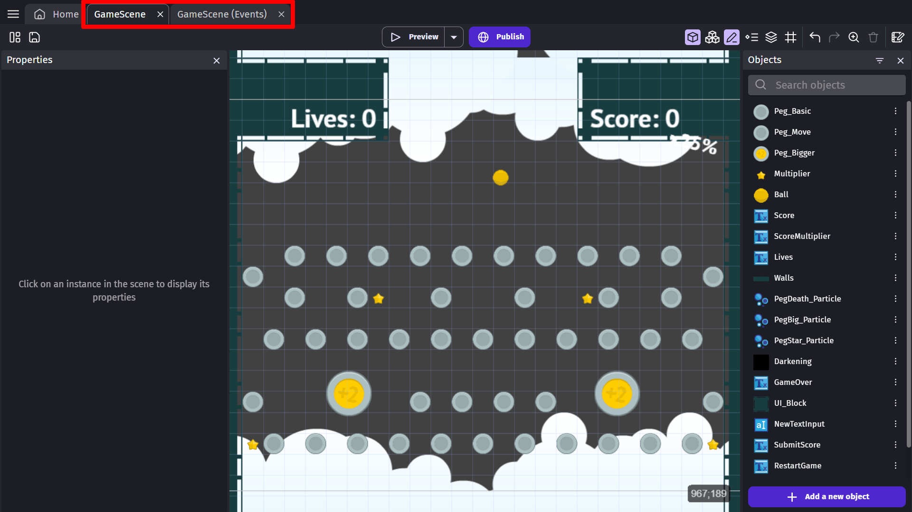

- The events sheet is a **tab beside the scene** (`GameScene (Events)`), not a separate window and not
  a mode inside a scene panel. Nothing else is docked around it — the events tab is full width.
- Toolbar (right side, 9 small icons, left to right): choose-and-add event ▾, add sub-event,
  add local variable, add comment, delete, undo, redo, search. There is no Save button: the project is
  saved as a whole, and unsaved state is a global dot on the tab.
- On an empty sheet the centre shows a large “Add your first event” button plus links
  (“+ Add a new event”, “Add...” at the bottom right of the sheet).

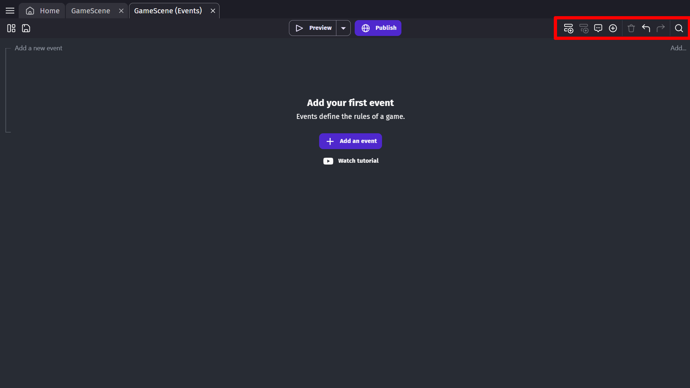

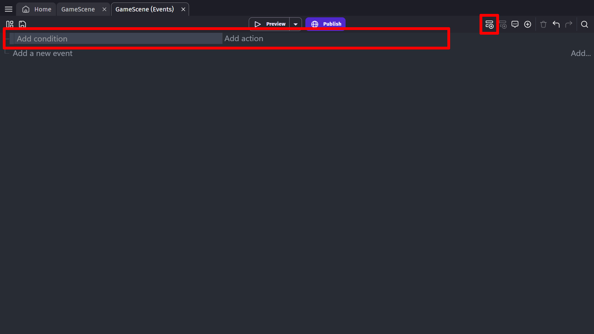

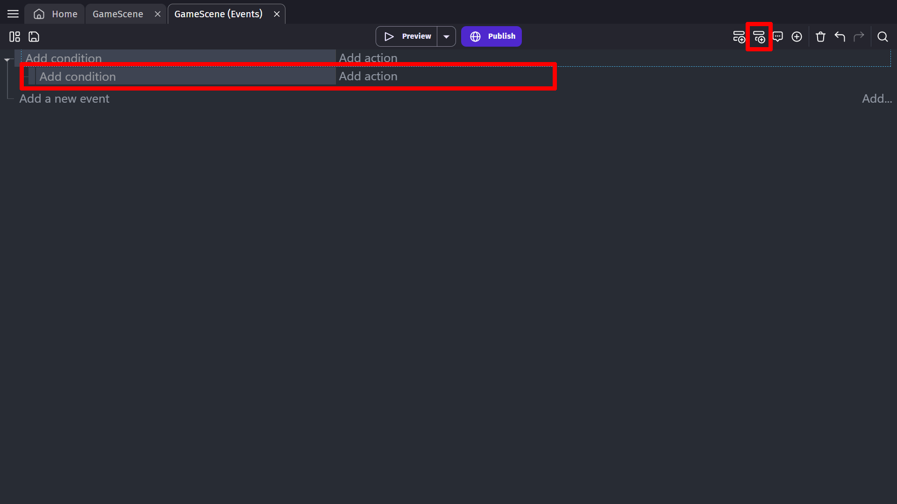

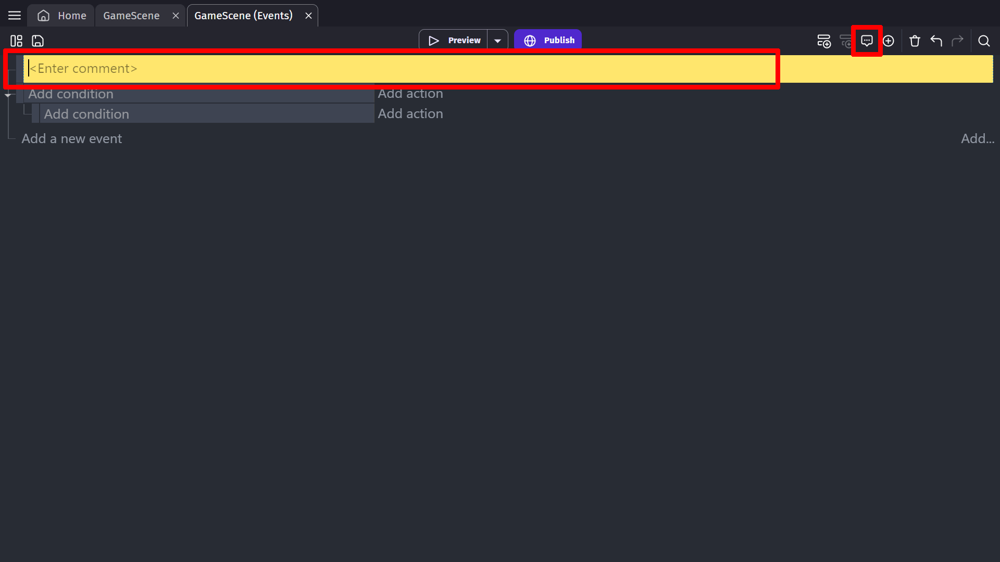

The three toolbar close-ups are the whole “add” vocabulary: a plain `+` adds a standard event,
the second icon adds a sub-event to the selection, the speech bubble adds a comment. Everything
else is in the ▾ menu behind the first icon.

### 2.2 One event = two columns of sentences

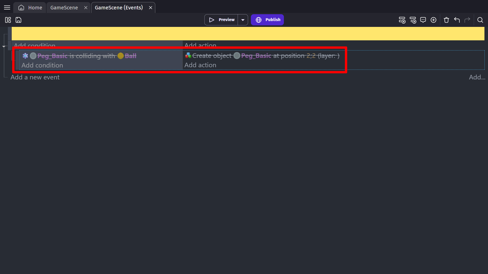

- A standard event is a single row block split **50/50**: conditions on the left, actions on the right.
  The column split is a **sized flex row**, not a table, and the split ratio is responsive
  (`ConditionsActionsColumns.js`: 35 % conditions on wide screens → 50 % on narrow, stacked on phones).
- Each instruction is **one line of prose**, e.g.
  `Peg_Basic is colliding with ● Ball` / `Create object ● Peg_Basic at position 2;2 (layer: )`.
  Object names are bold and tinted per object, and get a small coloured icon/thumbnail inline.
  Numbers and strings are syntax-coloured; variables, keys and mouse buttons get their own glyphs.
- Below the last condition there is an inline **`+ Add condition`** link, below the last action
  **`+ Add action`**. That is the *only* “add” affordance inside an event. Left-click adds
  immediately (opens the selector), right-click opens a quick menu of common/special instructions.
- There is **no per-event header**: no number, no title, no Enabled checkbox, no expand arrow in a
  header bar, no card border. The event is just its rows. Selected events get a tinted background;
  the left edge has a 10 px “handle” strip — transparent for a standard event, tinted for comments and
  groups — that is also the drag grip.

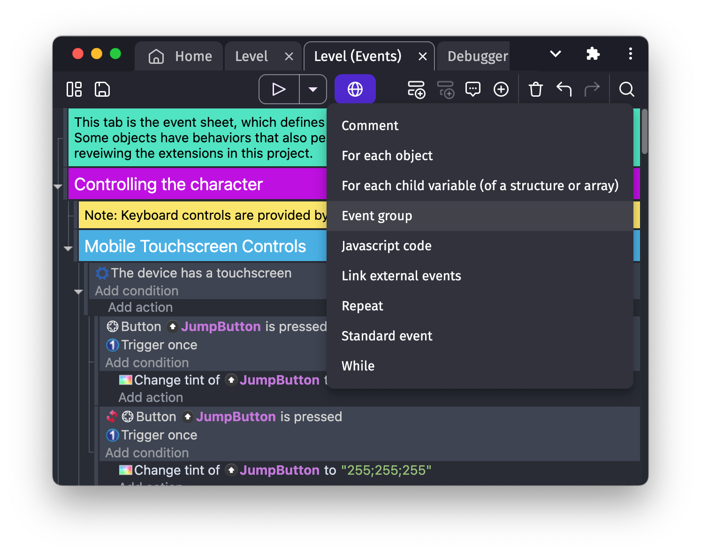

This screenshot is the best single reference for the target look:

- Comment events: full-width coloured bands (green), text edited in place.
- Group events: full-width coloured band with a larger title (purple), collapsible with a chevron.
- Sub-events: indented by 22 px with a thin vertical guide line and a chevron. No nested boxes.
- Instructions keep the same condition/action columns at every depth.
- Disabled text is drawn with `line-through` and 60 % opacity (`disabled-text` in `EventsTree/style.css`).

### 2.3 Event types are just different renderers

`EventsTree/Renderers/` holds one small component per event type. They all receive the same
`EventRendererProps` and are chosen by `EventsRenderingService.getEventComponent(event)`:

| Event | Presentation |
| --- | --- |
| `StandardEvent` | optional local-variable row, then conditions/actions columns |
| `ElseEvent` | the word **“Else”** or **“Else if”** in a narrow strip, then the same columns; a tooltip/invalid state explains when an `Else` has no preceding event |
| `GroupEvent` | full-width coloured bar with an inline-editable name (`1.3em`), collapsible |
| `CommentEvent` | full-width coloured band with an in-place `textarea`; text and background colours are editable from the right-click → Edit dialog |
| `RepeatEvent` | “Repeat … times:” + sub-events |
| `WhileEvent` | “While these conditions are true:” (its own conditions column) + sub-events |
| `ForEachEvent` | one header row (“For each object …”) + sub-events |
| `LinkEvent` | a band naming an external events file, with autocomplete |

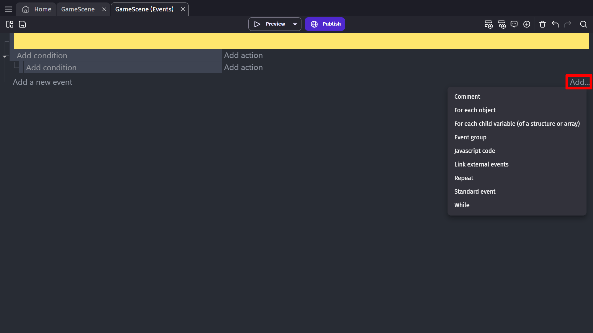

The “Add...” menu lists: Comment, For each object, For each child variable, Event group,
JavaScript code, Link external events, Repeat, Standard event, While. Note there is **no “Else”** in
this list: `Else` is reached by converting an existing event (right-click → Replace → “Make it a Else
for the previous event”) or by inserting below an existing event.

### 2.4 Editing a sentence: click the part you want

The instruction text is produced by `InstructionSentenceFormatter` from the instruction metadata’s
sentence template, then split into text runs and parameter runs. Text runs are plain spans; parameter
runs are focusable spans with a per-type inline renderer:

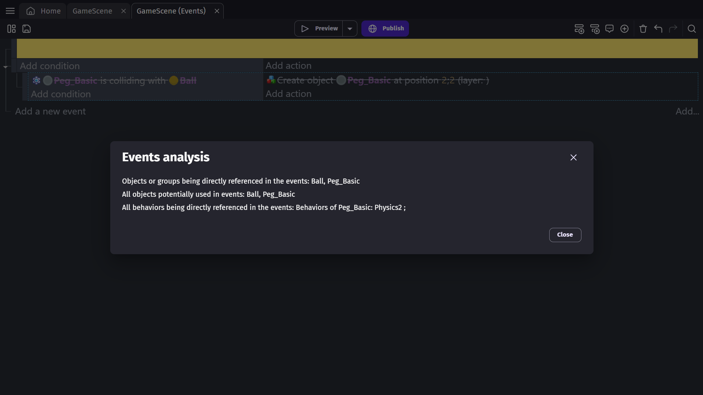

- **Click a parameter** → a small popover with the right editor for that parameter type
  (`ParameterFields/*`: object picker with thumbnails, key field, mouse button, layer, resource,
  variable picker with icons, colour, easing, relational operator, …).
  For trivial types the value is edited directly inline (`InlineParameterEditor.js`).
- **Double-click the instruction** (or select it and press Enter) → the full instruction editor
  dialog/popover: choose the instruction (search + tree, optionally filtered by object), then its
  parameters.
- **Right-click** → copy / cut / paste / delete, “Invert condition”, “Add a sub-condition”, help.
- **Drag** an instruction by its row and drop it above/below another one, or onto another event of
  the same column kind — conditions and actions cannot be dropped on each other.
- `+ Add condition` opens the same editor in “new instruction” mode. In `InstructionEditorMenu.js`
  the selector is a two-step flow: object-or-free-instruction list first, then that object’s
  instructions. Search is the primary control; there is no need to know the menu path.

The event right-click menu (from `index.js:_buildEventContextMenu`, illustrated in
`gdevelop5_interface_events-editor__20230313-182932.png`) is: Edit, Copy, Cut, Paste, Delete,
Select All, Deselect All, Toggle Disabled (D), Add ▸ (New Event Below / Sub Event / Local Variable /
Loop Counter Variable / Ordering / Comment / other event types), Replace ▸ (Make it a Else for the
previous event / Extract Events to a Function / Move Events into a Group / Analyze Objects Used in
this Event), Events Sheet ▸ (Zoom In, Zoom Out, Collapse All, Expand All to Level).

### 2.5 Colours, comments, groups

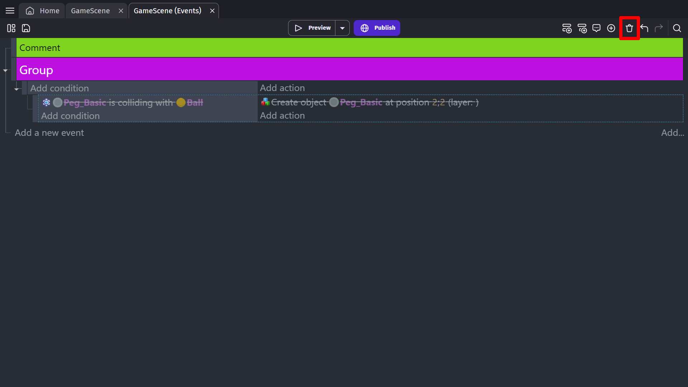


A group is only a *visual* container: it has a name, a background colour and a folded flag. It does
not change execution. Comments likewise are pure annotation. Both are edited by clicking the band
(text becomes a field) and via right-click → Edit for colours.

### 2.6 Else, and why it is good UX

An `Else` event is a row that runs only when the preceding enabled event’s conditions were false.
It can carry its own conditions (“Else if”), and chains (`if / else if / else`) are just consecutive
else rows. It is always drawn immediately below the event it belongs to, so the relationship is
visible without any wire. Disabled events and comments between them are ignored, and an `Else` with
no preceding event is flagged as invalid instead of silently doing something else.

This single construct replaces what ByteEngine does today with `flow.branch` nodes and
`TrueActionId`/`FalseActionId` wires.

### 2.7 Search and diagnostics

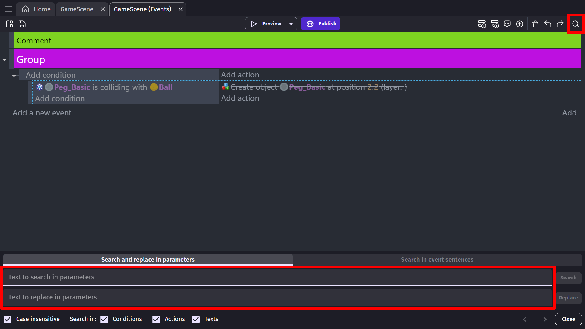

- A bottom strip with **Search and replace in parameters** / **Search in event sentences**, case
  sensitivity, and “Search in: Conditions / Actions / Texts”. Results are highlighted in place.
- A separate Global Search across all sheets and extensions.
- A diagnostic report (F7) lists missing/invalid instructions and parameters, with red underlines in
  the sheet and click-to-navigate.

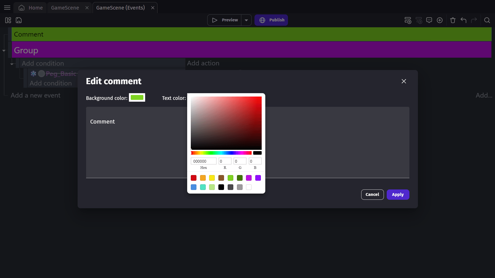

---

## 3. Why GDevelop's UI feels simple: the data model behind it

`Core/GDCore/Events/Event.h`, `EventsList.h`, `Instruction.h`, `Builtin/StandardEvent.h`:

```text
BaseEvent        { folded, disabled, type }
StandardEvent    : BaseEvent { conditions[Instruction], actions[Instruction],
                               subEvents[BaseEvent], localVariables }
ElseEvent        : same shape (own conditions/actions/sub-events)
GroupEvent       : BaseEvent { name, colour, subEvents }
CommentEvent     : BaseEvent { text, colours }
Instruction      { type, inverted, parameters[Expression], subInstructions[Instruction] }
EventsList       { events: vector<shared_ptr<BaseEvent>> }   // order == execution order
```

Three consequences matter for the UI:

1. **Order is the model.** There is no position, no link id, no first-action pointer. Rendering a list
   is a `for` loop; dragging is a list move. Our `NextActionId`, `TrueActionId`, `FalseActionId`,
   `ConnectedConditionIds` and `EditorX/EditorY` all exist because the graph is the model, and every
   one of them needs UI to keep it consistent (that is the 12.5k lines).
2. **Sub-structure is nesting.** `AND`/`OR` are not graph nodes: a condition that can have
   sub-instructions renders an inner `InstructionsList` (“Add a sub-condition”). Nesting is indented
   text, so it needs no layout engine.
3. **Sentences are metadata.** An instruction = type + sentence template + typed parameters. The
   editor never invents a layout; it substitutes parameter renderers into the template. Our
   `VisualInstruction` + `SentenceTemplate` already matches this — the registry is not the problem.

---

## 4. ByteEngine today (measured)

| Area | Files | Lines |
| --- | --- | --- |
| Event workspace UI | `Editor/ByteEngine.Editor/Panels/EventWorkspacePanel.{cs, Graph, Interaction, Layout, Arguments, Values, Sheet, SheetReorder, SheetTools}.cs`, `EventSheetProjection.cs`, `EventWorkspaceCollection.cs` | 12,542 |
| Visual logic core (model + registry + runtime) | `Engine/ByteEngine.Core/VisualLogic/*` | 6,159 |

What the panel currently shows at once:

- `Event sheet` / `Graph` / `View options` mode switch (`Graph.cs:DrawViewSwitch`).
- Toolbar: Save, Undo, Redo, + Event, + Comment, Collapse Selection, Arrange, Frame,
  `Events Auto/On/Off`, zoom −/%, zoom +, View, `...` (`Graph.cs:DrawDocumentToolbar`).
- Left **EVENTS** outline (search + numbered cards with “N conditions / M actions”).
- Centre: either the sheet or the node graph.
- Right **Details** pane (300–380 px) with the full parameter editor for the selected row.
- Inside the sheet: cards with an accent header, number, “Child:” prefix, Enabled checkbox,
  expand arrow, generated accent colour per event, per-row gutters, indent guides, drag handles,
  “+ Add condition” / “+ Add inside AND”, “+ Add action”, condition picker menus, group bands.

That is four navigation layers (outline → card → row → details), two representations of the same
data, and event chrome that GDevelop simply does not have. It also means the basics — adding a
condition, reading one event — take more clicks and more screen real estate than GDevelop.

---

## 5. Proposed ByteEngine Event Sheet v2

Target: one view, one sentence per instruction, structure by indentation, details on demand.
Everything below is a UI/interaction change; the runtime model can stay as it is (§6).

### 5.1 Layout

```text
┌ tab: <module name> · Event Sheet ─────────────────────────────────────────── [unsaved ●] ┐
│  + Event   + Sub-event   + Comment   + Group   │ ⌫ Delete   ↶ Undo   ↷ Redo   ⌕ Search  │
├─────────────────────────────────────────────────────────────────────────────────────────┤
│  CONDITIONS                                     │  ACTIONS                              │
│  Key W is held                                  │  Set velocity to 0;0;4                │
│  + Add condition                                │  + Add action                         │
│     ▾ Child event                               │                                       │
│       Distance to Player is less than 5         │  Play sound "step"                    │
│       + Add condition                           │  + Add action                         │
└─────────────────────────────────────────────────────────────────────────────────────────┘
```

- Delete the `Event sheet` / `Graph` switch from the default UI. Keep the graph reachable as a
  read-only “View → Graph” diagnostic (or a per-user advanced toggle), **not** as a peer mode with
  its own toolbar, because it forces every data-model decision to be graph-first.
- One toolbar row, icon-sized buttons with tooltips and shortcut hints, exactly the GDevelop set plus
  what we genuinely need: add event, add sub-event, add comment, add group, delete, undo, redo, search.
  Save is not a toolbar button (the panel already auto-saves when idle and shows a dirty marker in the
  title); keep a `Save` menu item and Ctrl+S for user confidence.
- Optional left rail: keep the EVENTS outline, but **collapsed by default** and reduced to
  “number + first condition sentence”. It is a jump list for 40-event sheets, not a second editor.
- Remove the right Details pane from the sheet layout. Selection details are edited in a popover
  anchored to the clicked parameter/row (see 5.4). Keep a place for “Advanced / raw values” in the
  same popover.

### 5.2 Event row anatomy

One row block per event: `[handle 10px][conditions column][actions column]`.

- No header band, no number, no checkbox. `Enabled` is a right-click/toolbar toggle and shows as
  strikethrough text (GDevelop's `disabled-text`).
- The handle strip is the drag grip **and** the selection indicator. Colour it per event only if the
  user set a colour; otherwise use the panel accent so the sheet does not look like a rainbow by
  default (our current `_sheetPalette` cycles six colours on every event automatically — drop that).
- `DisplayName` becomes optional metadata shown on hover and in the outline, not a visible header.
  `FunctionName` stays a subtle prefix when the event is a function entry.
- Sub-events indent by 22 px with a vertical guide and a chevron on the parent handle.
- Groups and comments become full-width bands above their members, with inline-editable titles
  (double-click), matching `GroupEvent`/`CommentEvent`. `EventGraphGroupDefinition.SheetGroup`
  already distinguishes the two.

### 5.3 Instruction rows

- One line, font size ~1.0× the panel default (not 1.12×), no card, no per-row fill. Condition rows
  get the blue accent on the text-left marker only; actions the orange one.
- Sentence from `SentenceTemplate` (already in the registry) with parameters substituted as
  **clickable chips**: object name bold + tinted, numbers/strings syntax-coloured, variables with a
  `{}` glyph, keys with a key glyph, booleans as `Yes`/`No`.
- `GetSheetSentence` already produces almost exactly this text; the change is to render it as
  segments with hit regions instead of one `AddText` blob, so each argument is clickable.
- Drop the “(Not connected)” row clutter. Unattached draft instructions become a single collapsed
  band at the bottom of the sheet (“3 unconnected drafts — show”), which is where the graph users can
  clean up.

### 5.4 Editing: click the part you mean

- Click a parameter → popover with the existing argument editor for that argument
  (`EventWorkspacePanel.Arguments.cs` already has specialised editors for rays, animation signals,
  audio clips, variables, objects, …). Reuse them inside the popover; no new editors needed.
- Click the row body → select. Double-click → “Edit instruction” popover: instruction search + all
  parameters stacked, with Apply/Cancel. This is the current Details pane, relocated and sized to the
  selection.
- Drag a row by its gutter to reorder inside its list. Drop on the condition or action column only.
  `SheetReorder.cs` already implements the reorder logic; it needs to follow the new row layout.
- `+ Add condition` → search-first popover. Default state: search box focused, list of matching
  instructions grouped by `GetVisualLogicMenuPath`, plus a **Recent** section (the last 6 used
  condition ids, persisted per user) and a **This object** filter derived from the last clicked object
  parameter. Enter adds the first match. Right-click on the link opens the old menu tree for people
  who browse by category.
- Delete = `Delete` key; Undo/Redo unchanged (`EventModuleHistory`).

### 5.5 Structure without wires

| Today | Proposed |
| --- | --- |
| `logic.and` / `logic.or` / `logic.not` nodes with `ConditionInputIds` wires and a separate “Add inside AND” button | Render as a **sub-condition list** inside the condition row: `All of these are true:` followed by indented child rows, each with its own `+ Add condition`. Same data, no wire editor. `logic.not` renders as `None of these are true:` and keeps the same child list UI. A single condition can be inverted from its context menu, like GDevelop's inverted conditions. |
| `flow.branch` with `TrueActionId` / `FalseActionId` | Render as two labelled sub-lists in the action column: `If true:` and `Otherwise:` with their own rows. The branch node itself becomes the two labels. |
| `rule.SubEvents` | Unchanged model; render as indented event rows (already supported by `DrawSheetRule(child, depth+1)` today). |
| “Child:” prefix on card titles | Removed; depth is the guide line. |
| Group membership lists (`MemberIds`) | Keep, but render as bands with fold/unfold, not as extra chrome on every event. |

This removes the need for ports, wires, marquee selection, auto-arrange, node scale, zoom and pan in
the primary workflow — roughly `EventWorkspacePanel.Graph.cs` (2,290), `Interaction.cs` (3,579) and
`Layout.cs` (1,378).

### 5.6 Keyboard and selection

Adopt the GDevelop bindings that cost nothing to implement and remove the graph-only ones:

| Key | Action |
| --- | --- |
| `Delete` | delete selected events/rows |
| `Ctrl+C/X/V` | copy/cut/paste events and instructions (sheet-level clipboard, conditions stay conditions) |
| `Ctrl+Z` / `Ctrl+Shift+Z` | undo/redo |
| `Ctrl+F` | search strip (parameters, sentences, instruction names) |
| `Ctrl+A`, `Ctrl+Shift+A` | select all / deselect |
| `D` | toggle disabled on selected event |
| `F2` | rename event/group/comment |
| `Ctrl+Enter` / `Ctrl+Shift+Enter` | add event below / add sub-event |
| `Alt+Up/Down` | move the selected instruction inside its list (already implemented) |
| `Enter` or double-click | edit selected instruction |
| `Escape` | close popover / clear selection |

Multi-select by click + `Shift`/`Ctrl`. No marquee needed for the sheet (keep it for the diagnostic
graph view).

### 5.7 Visual language

- Background: one panel background. Rows are separated by whitespace only. Selected event gets a
  subtle fill (8–12 % accent) and the handle brightens; selected instruction gets a 1 px border.
- Two accent colours only: blue (`#57AEEF`-ish) for conditions, orange (`#FFA14A`-ish) for actions,
  matching the current `SheetConditionColor`/`SheetActionColor`.
- Object text colour derived from the object/blueprint id (stable hash), like GDevelop tags object
  names by colour, instead of a per-event palette.
- Folded events show a chevron + dimmed `N conditions / M actions` suffix on the handle, not a header.
- The sheet must remain readable at 900 px panel width; below ~700 px the columns stack (conditions
  above actions), which is what `ConditionsActionsColumns.js` does for phones.

### 5.8 What we keep from today

- `SentenceTemplate` + `VisualArgumentDefinition` metadata (the registry already gives us GDevelop's
  sentence model).
- All specialised argument editors (`Arguments.cs`, `Values.cs`) — they become popover contents.
- `EventSheetProjection` (read-only projection of links) — it is exactly the right layer to feed a
  list renderer, and it already marks “Missing/Not connected/Circular” rows for diagnostics.
- Live trace dots (`VisualLogicTraceState`) — a small dot on the row edge is even better in a compact
  sheet than on a node.
- Auto-save on idle, undo routing, module settings, group/comment data, `.byteevents` format.

---

## 6. Data-model impact (for the later implementation, not done now)

Nothing in the `.byteevents` schema must change for the UI above:

- `Rule.Conditions` / `Rule.Actions` are already ordered lists.
- `HasExplicitConditionFlow`/`ConnectedConditionIds` and `HasExplicitExecutionFlow`/`FirstActionId`
  stay as the runtime truth; the sheet renders projections of them (`EventSheetProjection`).
- New rows appended by the sheet call the existing `ConnectCondition` / `AppendActionToExecutionFlow`
  helpers, so the graph view keeps working on the same data.
- Recommended follow-up (separate decision): make plain list order authoritative when a rule has no
  explicit flow — already the fallback in the runtime — and only materialise explicit links when a
  rule actually uses `logic.*` groups or `flow.branch`. That would let new sheets be pure lists,
  which is where the simplicity really comes from.

---

## 7. Implementation plan (suggested, smallest useful steps first)

1. **Toolbar + layout trim** (low risk): drop the mode switch from the default view, remove
   Arrange/Frame/zoom/View/`...` from the toolbar, remove the Details pane from the sheet layout,
   keep `View → Graph (advanced)`.
2. **Event rows become plain rows**: remove card child windows, header bands, numbers, per-event
   palette, Enabled checkbox, “Child:” prefix; add 10 px handle, indent guides, bands for
   groups/comments.
3. **Instruction chips**: split the sentence into segments; make each parameter clickable; open the
   existing argument editor in a popover.
4. **Add-condition search popover** with recent list, replacing the menu-tree-first flow.
5. **Sub-condition rendering** for `logic.and/or/not` and **labelled sub-lists** for `flow.branch`.
6. **Search strip** (parameters/sentences) reusing the existing outline search field.
7. **Keyboard pass** (`Delete`, `Ctrl+C/X/V`, `Ctrl+F`, `D`, `F2`, `Enter`).
8. Only then consider deleting the graph code; until then it stays as an advanced view over the same
   data, so nothing is lost.

Each step is independently shippable and keeps the runtime untouched, so gameplay in Dune Company,
the FPS template and the Wildling module keeps working throughout.

---

## 8. Risks and edge cases to keep in mind

- **Object references.** GDevelop's picking model lets a condition filter instances for the actions
  of the same event. ByteEngine uses explicit `target` arguments (`Self`, `id:<guid>`), so the
  sentence must always say which object an action affects. Do not copy GDevelop's implicit picking
  semantics; copy its *presentation*.
- **Plugin instructions** have free-form argument sets and sometimes no `SentenceTemplate`
  (`GetSheetSentence` already falls back to “Name - Label: value”). The chip renderer needs that
  fallback so unregistered/legacy instructions stay editable.
- **Multiple target Blueprints.** Event modules can target a Blueprint; the sheet must keep showing
  when an instruction’s object is missing (the projection already reports “Missing object”).
- **Live trace** needs a stable row identity — `InstanceId` already provides it; keep the dot on the
  row’s gutter so it survives folding.
- **Undo granularity** must stay one action per user gesture (the current `RecordHistory` pattern),
  especially for popover edits with Apply/Cancel.
- **Narrow docks.** The sheet must survive ~700 px panels (docked beside the Scene View). Stack
  columns below that width instead of hiding content.
- **Autosave during editing.** `_autoSaveIdle` must not fire while a popover holds uncommitted
  parameter edits; gate it on the same “no open editor” flag the graph uses for drags.

---

## 9. Open questions

1. Should the graph disappear entirely for new users, or stay behind an explicit
   “Advanced: graph” toggle? (Recommendation: hidden by default, discoverable in View options.)
2. Do we want `Else` as a real event type (new `Rule` flag or a `flow.else` marker) so if/else chains
   read as consecutive rows instead of a `flow.branch` inside one event? That is a runtime-adjacent
   decision and needs a separate proposal.
3. Are event `DisplayName`s used by users (they appear in traces and the outline), or can they become
   hover-only text?
4. Which of our specialised argument editors are important enough to keep inline (e.g. ray direction
   mode) versus popover-only?


